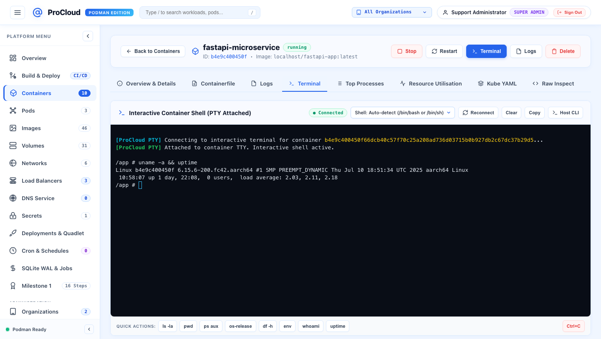

# Interactive Container Terminal & Host PTY Attachment

ProCloud provides a high-performance, real interactive terminal session attached directly to running container namespaces via host-native pseudo-terminals (PTY) and WebSockets.



---

## Architecture Overview

Unlike basic HTTP command receivers that execute one-off commands and wait for process exit, ProCloud establishes a continuous, full-duplex interactive terminal stream:

```
[ Browser / xterm.js ] <== WebSocket (JSON / Raw Binary) ==> [ ProCloud API Server ] <== PTY (/dev/pts/*) ==> [ Podman Container ]
```

1. **Host-Native PTY Master**: Allocates a true pseudo-terminal file descriptor on the Linux/macOS host via `github.com/creack/pty`.
2. **Container Shell Attachment**: Attaches the PTY to `podman exec -it <containerID> <shell>` (or `podman attach` for PID 1 console).
3. **Bi-Directional Streaming**:
   - Keystrokes, control characters, and escape sequences stream immediately from browser to PTY.
   - Stdout and Stderr chunks from the container stream over WebSocket directly into the `xterm.js` viewport.
4. **Dynamic Window Resizing**: Viewport size changes emit `{"type": "resize", "cols": N, "rows": M}` events that invoke `pty.Setsize` on the server, ensuring curses apps (`top`, `vi`, `htop`) render accurately.

---

## Strict Per-Container Isolation

To prevent cross-container output bleed (e.g. commands from Container A appearing when inspecting Container B):

- ProCloud maintains an isolated client-side session map: `containerTerminalSessions = new Map()`.
- Each container maintains its own dedicated `Terminal` instance, DOM viewport, WebSocket connection, and shell buffer.
- Switching between containers unmounts the previous container's terminal DOM and mounts the selected container's terminal without destroying active sessions.

---

## Features Supported

- **Curses & Interactive Tools**: Seamlessly run `vi`, `nano`, `top`, `htop`, `less`, `python`, and `node` REPLs.
- **Signals & Interrupts**: Transmits `SIGINT` (`Ctrl+C`), `EOF` (`Ctrl+D`), and `SIGQUIT` (`Ctrl+\`).
- **Tab Auto-Completion**: Shell auto-completion works natively within the container filesystem.
- **Quick Actions Bar**: 1-click execution chips for `ls -la`, `pwd`, `ps aux`, `df -h`, `env`, `whoami`, `uptime`, and emergency `Ctrl+C`.
- **Zero External CDN Dependencies**: Bundled with self-hosted `xterm.js` and `xterm-addon-fit.js` inside `/vendor/xterm/`.
